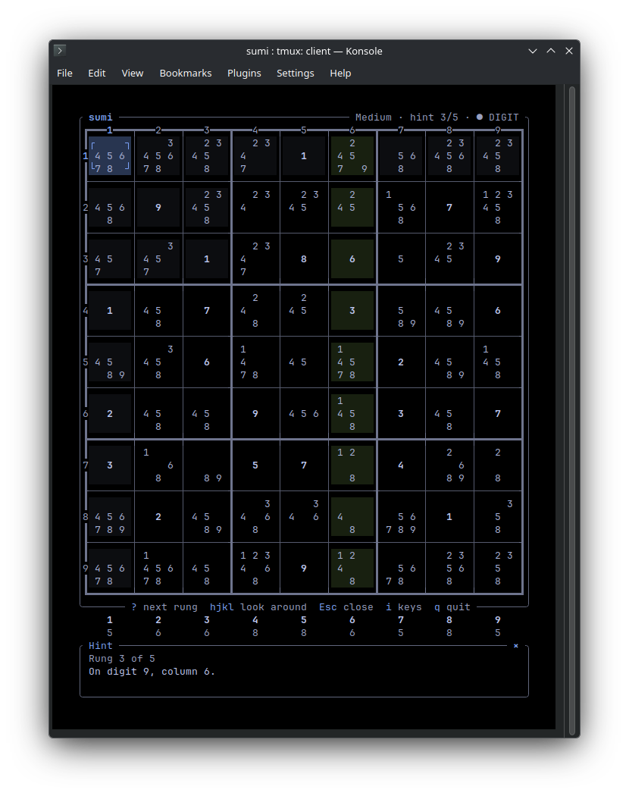
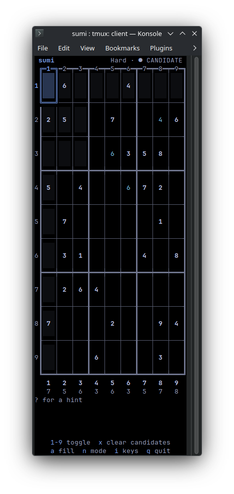
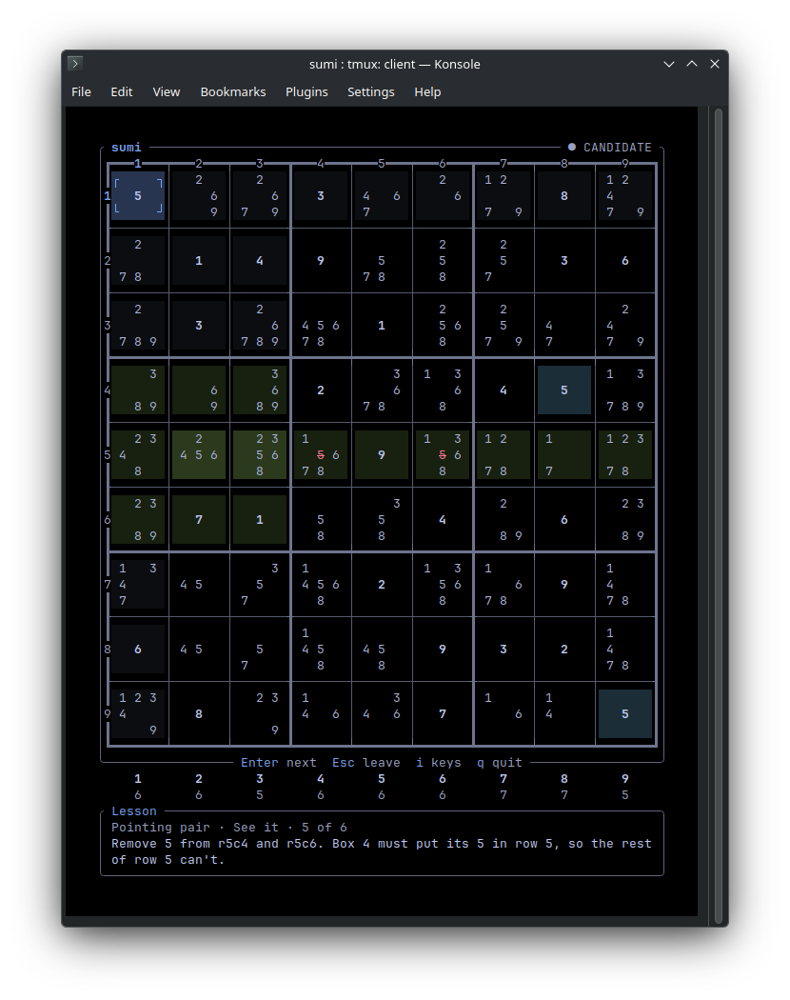

# sumi

A calm Sudoku game for the terminal that teaches you to solve. Ask for a
hint and it names the easiest step on the board. It tells you one rung at
a time: how hard the step is, what to look for, where, which cells, and
only then the move.



## What it does

- **Hints that teach.** Each hint climbs a ladder of five rungs, and you
  stop at the rung you need. The step is always the easiest one sumi's 20
  techniques find, from full house to simple colouring. Apart from hints,
  `c` marks the digits that differ from the solution and `r` reveals one
  cell.
- **Learn.** A lesson for each Easy and Medium technique shows the pattern,
  then has you finish it and find it on three boards. A drill for every
  technique gives you five puzzles stopped just before it.
- **Calm by default.** There is no timer, no stats and no streaks until
  you turn the timer or the stats on in the settings. Nothing else keeps
  score.
- **Everything can be switched off**: each highlight, the animations, the
  key bar, the digit pad, the mouse.
- **Four levels**, Easy to Expert, graded by the hardest technique a puzzle
  needs. Hard and Expert are dealt from a bank of 1,000 checked puzzles,
  each shown relabelled and moved. Once a level's bank is played, and for
  Easy and Medium always, puzzles are made on the spot. You can also type
  in a puzzle from paper, with the digits you have solved so far.
- **Your game is kept.** It is saved after every move, and `sumi continue`
  picks it up. Bookmarks (`b`, then `B` to go back) let you try a guess.

## Install

Download a binary from the
[releases page](https://github.com/dsvarela/sumi/releases): static builds
for x86_64 and aarch64 Linux, builds for macOS on Apple silicon and Intel,
and one for x86_64 Windows 10 or later. Each archive holds the `sumi`
program (`sumi.exe` on Windows); put it anywhere on your `PATH`. The macOS
builds are not notarized, so macOS refuses one downloaded with a browser
until you clear its quarantine:

```bash
xattr -d com.apple.quarantine sumi
```

The Windows build is not signed either, so SmartScreen may warn about it
the first time; More info, then Run anyway, starts it.

Or build it from this repository, with Rust 1.88 or later:

```bash
cargo install --locked --git https://github.com/dsvarela/sumi sumi-sudoku
```

The program it installs is called `sumi`.

## Play

```bash
sumi
```

The menu offers New game, Custom puzzle, Learn, Settings and Quit, with
Continue first while a game is saved. To skip it:

```bash
sumi new hard
```

In a game, `i` lists every key. These are enough to start:

| Key | Does |
| --- | --- |
| arrows or `hjkl` | move |
| `1` to `9` | place a digit, or toggle a candidate or mark |
| `n` | switch between digits, candidates and box marks |
| `a` | fill in every candidate |
| `?` | a hint, then its next rung |
| `Esc` | close the hint, clear checks, or open the pause menu |

With the mouse on, a click or tap on a cell, a pad digit or a menu item
works too.

`sumi rate` grades a puzzle, or a list of them on standard input, and
`sumi gen` prints new ones.

## Small windows

sumi needs 75×46 for its full layout. In a narrower window it switches to
a dense layout that fits 38×47, or 38×45 with the digit pad hidden. The
settings page has a narrow form that fits there too. sumi runs in Termux
on Android with the aarch64 Linux build, though it is not tuned for it.



## Settings and files

The settings page writes `config.toml`, keeping any comments in it. sumi
follows the XDG base directories, on macOS as well. A variable counts only
when it holds an absolute path. Without one, Windows uses its own folders.

| What | Where | On Windows |
| --- | --- | --- |
| `config.toml`, and your own themes in `themes/` | `$XDG_CONFIG_HOME/sumi`, or `~/.config/sumi` | `%APPDATA%\sumi` |
| The saved game, the bank puzzles played, the stats | `$XDG_DATA_HOME/sumi`, or `~/.local/share/sumi` | `%LOCALAPPDATA%\sumi` |

Seven themes are built in, Tokyo Night AMOLED by default. Paper is a light
one, and Colour-blind safe uses the Okabe-Ito palette. A theme is a TOML
file of colours; the built-in ones are in
[`crates/sumi-sudoku/themes`](crates/sumi-sudoku/themes). `NO_COLOR` is
honoured.



## The engine

The solver, generator, grader and hints are a separate library,
[`sumi-core`](crates/sumi-core), with no terminal code.

## Licence

MIT. sumi is written from scratch. Its technique order and test positions
draw on HoDoKu and SudokuWiki, but no code is taken from either.

The screenshots are Konsole on KDE Plasma with JetBrains Mono, at the
window sizes given, from real runs of the build they came with. sumi ran
inside tmux, its status bar off, so that keys could be sent to it.
